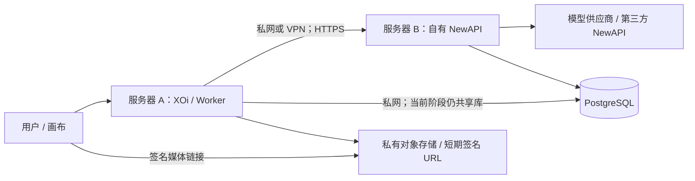

# NewAPI 异机接入与画布上线方案

日期：2026-10-09。依据：当前仓库代码及 NewAPI 官方源码/文档。本文为预判与实施方案，未连接拟上线服务器、未改现有网关配置，也未执行付费模型调用。目标服务器归属和版本尚未确定，覆盖两种情况。

## 结论与推荐路径

可以把 NewAPI 放到另一台服务器；但“同一种软件”不等于“任意实例的全部接口、账户、模型、价格都一样”。当前 XOi 对 NewAPI 同时承担三种依赖：登录与身份、额度与经营功能、模型推理。

| 接入方式 | 当前可行性 | 条件/限制 |
| --- | --- | --- |
| 原 NewAPI 原版本搬到我们控制的服务器 B | 可实施，改动最少 | 保留完整数据库和用户 ID；XOi 与 B 的 PG 仍须私网连通；检查外链、网关秘钥与版本 |
| 我们控制的一套新 NewAPI，能管理数据库及账号 | 需要迁移/适配 | 不能直接用新用户 ID 替换旧 ID；认证、管理 API、数据库结构和媒体协议需验收 |
| 第三方只提供地址和模型 API Key | 当前不能直接替换整站依赖 | 不具备共享 PG、用户管理和每用户额度权限；只能提供推理服务，不能自动接管我们的账号/充值/代理体系 |
| 第三方作为自有 NewAPI 的上游渠道 | 推荐 | 自有网关保留账户和账务，第三方只承接模型请求；仍须核对上游协议、价格、速率和模型能力 |

推荐保留一套我们控制的 NewAPI，迁到服务器 B；需要第三方模型资源时，把它配置为 B 的上游渠道。三方 Key 只存于 B 的渠道配置，浏览器只访问 XOi，使用者额度仍由自有 NewAPI 扣减。该方案能兼顾更换供应商与保留现有经营功能。

首期建议 A、B、PG 处于同地域低延迟网络，PG 不向公网开放。若跨云，通过受控 VPN/专线连接，仍需压测丢包、带宽与数据库 RTT。第三方只给 Key 时，C 可以替换；B 仍由我们控制。

## 当前代码的具体依赖与不兼容点

1. `backend/src/utils/db.ts` 将业务表与 NewAPI 表放在同一个 PostgreSQL。身份、用户令牌、代理收益、团队额度读写依赖 `users / tokens / logs / channels`。HTTP 换成远端但 PG 保持另一套用户，可能产生身份、令牌、余额不对应，不能作为有效配置。
2. `backend/src/lib/gateway/newapi.ts` 每次获取调用凭据都通过事务查用户、查令牌，必要时直接写 `tokens`；依赖当前 token 格式与表字段。只有一个普通模型 Key 无法使用此流程。
3. `backend/src/utils/newapi.ts` 登录只接受 `access_token + user`。新版本官方源码具有此结构，但旧 Session 版本及不同发行分支不能默认兼容。以拟部署实例的准确 release/commit/image digest 验证，不能用 upstream main 证明目标版本一定可用。[官方认证源码说明](https://github.com/QuantumNous/new-api/blob/main/docs/authentication.md)。
4. **身份读取是上线阻断项**：当前 `newApiSelfByAdmin(uid)` 使用管理员令牌请求 `/api/user/self` 并附加 `New-Api-User: uid`。官方管理文档要求相应头与当前身份匹配；新认证说明又不要求该头。不能认为此头允许管理员冒充任意用户；某些版本会拒绝，另一些可能返回管理员自己，进而影响余额及角色判断。适配为经确认的“按 ID 管理查询”，或者经本方受控数据库查询目标账号；必须断言返回 `id === 请求 uid`，不符立即拒绝，不能回退使用管理员身份。[官方管理认证说明](https://docs.newapi.pro/zh/docs/api/management/auth)。
5. 图片供应商发送 `images[] / resolution / aspect_ratio`，视频发送 `/v1/videos`、`input_reference / images[] / videos[] / audios[]` 等。这些能力不能只凭 `/v1/models` 中出现模型名判断；不同渠道可能要求 multipart、专有端点或不同参数。官方文档也列出了 OpenAI 视频、Kling、旧视频等多种协议，具体由实例渠道/适配器提供。[官方任务接口说明](https://docs.newapi.pro/zh/docs/guide/feature-guide/user/log)。
6. 网关根地址与推理 `/v1` 地址的归一化需统一。`NEWAPI_BASE_URL` 首期填写根地址，不附 `/v1`；登录客户端否则可能拼出 `/v1/api/user/login`。模型同步、画布、后台价格同步必须指向同一实例。
7. 价格显示有本地换算及表达式解析，不能默认另一站同名模型同价或“500000 quota 等于 1 元”。须核对额度单位、币种、汇率、分组倍率、视频时长/清晰度价格，以及代理加价。[官方版本记录涉及定价变化](https://docs.newapi.pro/en/docs/guide/wiki/changelog)。

## 画布上线前优化顺序

### P0：接入正确性与资金/任务一致性

- 统一 Gateway Adapter：定义文本流、图片、视频提交/查询/内容、TTS、模型能力、身份、价格的明确契约。当前供应商接口、`canvas-llm` 与 `/api/v1` 代理分散，逐项纳入同一适配和异常策略。
- 加入连接诊断：检查版本、认证模式、目标账号 ID/角色、数据库结构、模型 Key 所属用户/组、模型清单、收费单位。只能确认连通的检查不能宣称图生图和视频功能通过；收费能力探测必须使用预算受限的测试账号。
- 修复上述 `/self` 身份假设；核验 NewAPI 密码/角色变更的 `auth_version` 或相应撤销机制与 XOi 自身 JWT 的关系。身份/计费错误必须失败关闭，不能切到公共 Key 或管理员身份。
- 将画布任务写入业务数据库，Worker 恢复轮询。存储 `ownerId / gatewayInstanceId / upstreamTaskId / model / credentialRef / 状态 / deadline / billingReference / 输出对象键`，凭据加密或存秘密引用，不明文记入任务/日志。
- 统一超时：现有画布视频 15 分钟 watchdog，供应商视频轮询 20 分钟，随后还有下载。前端等待、单次网络请求、上游任务截止和媒体下载需分开；不能在 15 分钟直接把合法 20 分钟任务判失败。网络超时先标记“待确认”，查询上游及账务后再收敛终态。
- 提交请求超时不得盲目自动重发，也不得直接切换网关重做：上游可能已接受并扣费。使用本地幂等键和持久化提交状态，上游支持幂等时透传；不支持时保留未知状态并对账。
- 为模型维护能力清单：支持的端点、参考图数量、URL/Base64/multipart 格式、清晰度、时长、音轨、输出格式与价格版本。UI 只开放已确认的组合，配置变更刷新缓存。

### P1：跨服务器性能与媒体链路

- 减少热路径串行数据库往返：令牌创建只在首次/失效时进入创建事务；对稳定配置及已验证的凭据引用短时缓存并合并并发请求。账号封禁、角色、额度和令牌撤销不能用长期缓存绕过校验；缓存失效必须有明确机制。
- 字节流优先：现有视频 `/content` 下载完整二进制后转 Base64，再由业务层解码。改为流式写对象存储，避免多个全文件副本；Base64 体积约增加三分之一，尤其影响参考视频上传。
- 大媒体采用私有对象存储和短期签名 URL；签名有效期覆盖上游取文件的排队窗口。`localhost / 127.0.0.1 / /oss/...` 相对地址不能作为远端上游的取图地址。纯文本多模态消息也需统一参考资源解析。
- 若网关返回私网媒体 URL，现有用户外链安全守卫会拒绝：应使用可信网关固定的内容端点或签名对象存储，不放开任意用户内网 URL。
- 全链路 SSE 保持流式：A、B 的反向代理关闭相应接口缓冲，使用连接复用；限制连接数、空闲时间和总执行时间。不要把全部流攒完后一次返回。
- Worker 自适应轮询，考虑上游 `Retry-After`，避免大量用户每秒轮询。前端通过 SSE/Socket 获取本方任务状态，服务端集中访问上游。

### P2：逐步减少共享数据库耦合

长期把 XOi 业务表迁到独立业务库，以 `gatewayInstanceId + remoteUserId` 建立映射，停止把两个实例的数字用户 ID 当作同一身份。NewAPI 维持推理与扣费权威；代理、团队、充值记录必须设计持久化操作单、幂等、事务 outbox、补偿与对账。

此阶段不能简单把同库事务换成两个 HTTP 调用。`mc_*` 经营关系、分组变更和额度变更存在跨系统失败窗口；全部能力完成适配前，不切换到纯第三方 API 模式。首期先异机同库，保留当前事务能力，同时隔离网络/权限。

## 安全收益与限制

异机部署有助于隔离资源、网络入口和故障范围，但主站仍持有管理令牌和数据库权限时，主站被攻破后仍可能触及网关与账号数据。真正收益来自：

- PG/Redis 只开放私网，访问规则限定服务身份/来源，使用传输加密与证书校验。
- 分离迁移账号和运行账号，限制业务程序可操作的表、字段与管理能力。当前启动时仍会建表/迁移，须先抽离初始化流程，不能直接撤掉 DDL 权限后宣称兼容。
- NewAPI 管理台仅授权运维入口访问；模型请求 Key 与管理凭据分开，Key 设置来源 IP/可用模型/预算边界并可轮换。
- 第三方接收生成所需的提示词及参考素材。只传最少任务数据，使用短期签名资源，不发送数据库凭据、用户登录密码或本站管理令牌。
- 不执行未经确认的数据库覆盖、用户 ID 对齐或账务迁移；保留审计与可恢复备份。

## 速度预判与验收指标

未提供 B 的地域、链路和配置，因此以下是影响机制及验收建议，不是实测结果：

| 操作 | 主要影响 |
| --- | --- |
| 打开/保存画布 | 当前业务库与 NewAPI 同库；PG 若远端高延迟，节点保存、资源列表、登录也会受影响，不仅是生成 |
| 文本首字响应 | 多一段 HTTP 建连/网络往返及鉴权查询；连接复用、同地域低 RTT 和 SSE 流式可减轻 |
| 图片/视频生成 | 生成及上游排队通常更关键，但跨服务器参考文件上传、下载和多次数据库往返可能显著增加总时长 |
| 大文件播放/下载 | 网关/对象存储带宽、用户地域和 CDN 路由为关键；额外转存及 Base64 处理也会延迟 |

例：一次请求若串行产生 8 次数据库往返，远端 RTT 为 20ms，网络等待约 160ms，尚未计入查询、网关和生成时间。这只是算例；优化重点是减少串行往返和避免将业务库放到高延迟跨境链路。

比较 A→旧网关与 A→B 两组：HTTP RTT、DB 简单查询 p50/p95、登录/画布保存 p95、文本首 token p95、图片/视频成功率与排队/生成时间、大文件有效吞吐、超时率、内存峰值。首期把 A→PG p95 RTT 10ms 作为工程目标而非保证；真实链路达不到时，先测业务指标再选地域或重构。

允许文本/生成请求有小幅额外网络开销；画布保存的 p95 回归建议不超过基线 20% 或团队约定的绝对阈值。目标必须以固定测试集、相同模型渠道、相同并发和完整样本比较。

## 上线执行步骤与回滚

1. 明确 B 是自有可控实例还是第三方 Key；记录版本/digest、PG 版本、模型/渠道、价格及账号管理权限。
2. 使用隔离测试库及测试账号演练。原实例迁移到空目标库时，迁移完整 NewAPI + XOi 数据并保留 ID、额度、日志、关系和序列；用户媒体仍留在 A/对象存储。不同独立实例的已有 ID 不得直接合并，更不能覆盖第三方数据库。
3. 配好私网/VPN、HTTPS/证书、受限数据库账号和备份。若首期原实例异机同库，切换三项配置：根 `NEWAPI_BASE_URL`、匹配同一实例的 `NEWAPI_DATABASE_URL`、该实例有效的 `NEWAPI_ADMIN_TOKEN`。Compose 原 `newapi` 外部网络是单 Docker 主机配置，不能当作跨服务器网络，需改成 A 本地部署网络并建立真实网络路由。
4. 逐项通过功能矩阵：普通用户/管理员登录与余额归属，旧账号项目/画布归属，封禁/降权/改密，模型权限，文字/多模态/图片/多参考图/视频提交与恢复/TTS，额度不足/429/上游断线/下载失败，计费与失败状态对账。
5. 冻结新增生成与账务写入，等待或记录旧任务，进行最终增量迁移/一致性核对。切换后旧实例停止承接新任务，避免双活分叉。
6. 小流量灰度再全量。任务固定到提交时的网关实例与凭据引用，不因全局地址变更去新网关查询旧 taskId。监控延迟、失败率、额度异常和数据可见性。
7. 回滚前识别切换后的用户/任务/额度写入并对账，不简单恢复旧配置导致账务回退。保留旧网关直到旧任务收敛；强制重新登录或保留会话应按密钥/认证版本变化做明确选择。

首期上线门禁：身份返回 ID 断言及权限测试通过；模型能力契约通过；任务超时/未知状态处理统一；迁移无错绑账号/重复扣费；私网与媒体可达性通过；数据备份可恢复。本文没有把这些待实现项目描述为已经完成。
