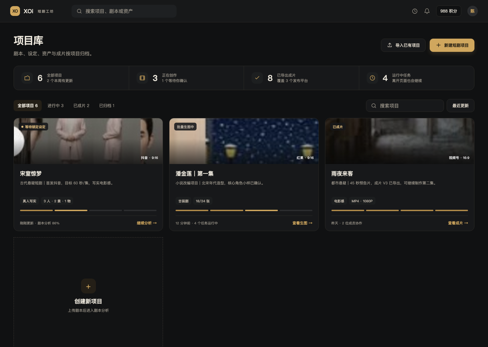
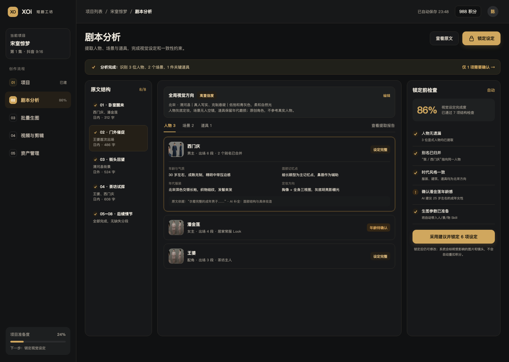
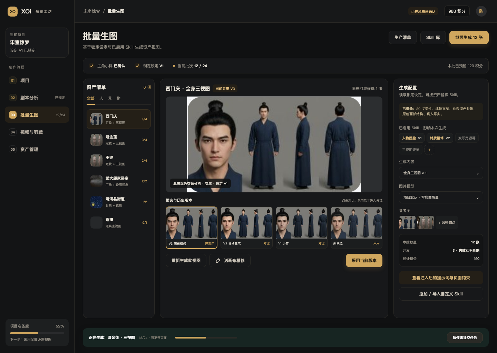
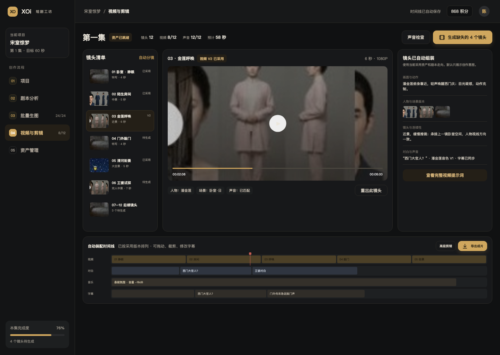
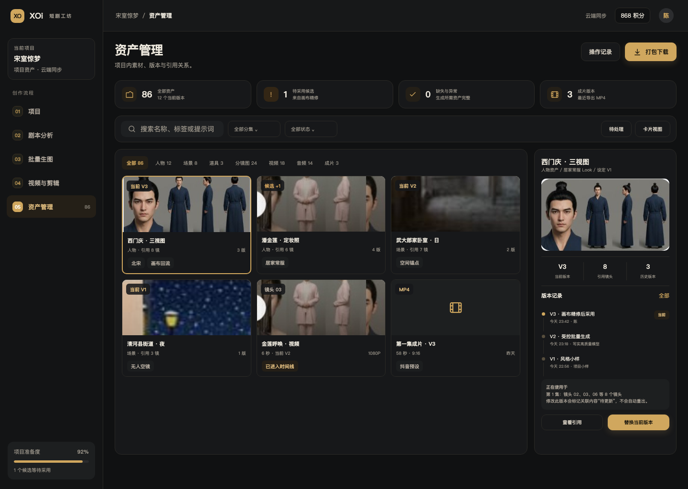

# XOi 短剧工坊｜页面设计图与细节功能说明

设计基准：1440 × 1024 px，桌面端高保真静态设计。  
视觉方向：影院黑金——近黑炭色底、做旧金强调、暖白文本、细边框与低阴影，以视听语言为主。  
V1.1 修订：收敛界面文案，批量生图增加可见 Skill 库、Skill 启用与自定义 Skill 入口。  
配套文档：`XOi短剧工坊-产品方案与PRD.md`。

## 设计图索引

1. [项目首页](designs/01-项目首页.png)
2. [剧本分析页](designs/02-剧本分析页.png)
3. [批量生图页](designs/批量生图页.png)
4. [视频生成与剪辑页](designs/视频生成与剪辑页.png)
5. [资产管理页](designs/资产管理页.png)

可在浏览器打开 `designs/designs.html` 查看完整五页源稿；单页导出使用 `?only=design-01` 至 `?only=design-05`。

---

## 一、项目首页

### 设计意图

把“快速创作/导演创作”的模式切换从首页移除。用户只面对项目文件夹，不需要先理解产品内部有几种工作流。首屏只回答三个问题：我有哪些项目、进行到哪、下一步点哪里。

### 区域说明

| 区域 | 内容与交互 |
|---|---|
| 顶部栏 | 全局搜索可搜索项目、剧本和资产；任务入口展示后台运行状态；积分与账号保持轻量 |
| 首屏标题 | “项目库”直接说明页面内容；次操作为导入已有项目，主操作为新建短剧项目 |
| 概览条 | 仅展示项目、创作中、已导出、运行中任务四类有用信息，不做运营数据大屏 |
| 项目筛选 | 全部/进行中/已成片/已归档；支持搜索、最近更新排序和卡片/列表切换 |
| 项目文件夹卡 | 封面、当前状态、发布平台、项目备注、资产概况、阶段进度、最近更新时间和唯一下一步 |
| 新建空卡 | 与顶部新建按钮行为一致，降低首次使用寻找成本 |

### 新建项目弹窗细节

- 默认只展示：项目名称、上传/粘贴剧本、项目备注、目标平台。
- 高级设置折叠：文字/图片/视频/声音模型、画质、画幅、风格、团队成员。
- 选择平台后自动建议画幅和导出预设；用户可改，不必理解模型参数。
- 主按钮为“创建并分析剧本”；没有剧本时可“先建空白项目”，但不作为默认。

### 关键状态

- 有待确认项：项目卡状态使用琥珀色，并将下一步写成“确认 2 项设定”。
- 后台生成中：显示真实任务数和“离开也会继续”，不阻塞打开项目。
- 已成片：下一步为“查看成片”，同时保留“制作下一集”。
- 无项目：用示例项目和上传剧本两种入口，不显示空白统计。

---

## 二、剧本分析页

### 设计意图

把“分段进度、全局风格、三类资产设定、锁定检查”放在同一屏。用户看到的是人物与场景，不是模型提示词；系统复杂性被收纳到提取报告和完整设定中。

### 区域说明

| 区域 | 内容与交互 |
|---|---|
| 左侧原文结构 | 每个分段显示标题、人物、内外景、字数和完成状态；失败段可单独重试 |
| 全局视觉方向 | 时代、地域、影像风格、色彩光线、图片制作方向和原创约束；修改会影响全部资产 |
| 人/景/物标签页 | 显示提取数量和报告入口；所有资产均可展开编辑 |
| 资产设定卡 | 展示年龄气质、面部记忆点、年代服装、定妆方向及原文证据；场景与道具使用各自字段 |
| 锁定前检查 | 完成度、漏提检查、别名归并、时代一致性、低置信度项和生图准备状态 |
| 主行动 | “锁定设定”，一键采用高置信度建议，仍允许逐项修改 |

### 人物设定抽屉

采用分区而非长文本框：

1. 基本身份：标准名、别名、年龄、身份、出场范围。
2. 面部结构：脸型、比例、主记忆点与辅助五官。
3. 气质表达：表情、眼神、妆面。
4. 年代造型：服装、面料、发型、配饰。
5. Look 管理：居家、宴席、老年等时期/服装变体。
6. 生图方向：胸像、三视图、背景、光线、负面约束。
7. 原文证据与 AI 推断：明确区分来源。

### 场景与道具

- 场景必须填写空间连续性锚点和时间/天气变体；默认生成无人空镜。
- 道具必须填写时代、材质和剧情状态；只提取影响剧情的关键道具，避免资产膨胀。

### 长剧本与询问策略

- 分段自动在后台执行，不逐段弹窗。
- 仅高影响冲突进入右侧检查，例如时代不明、实体无法归并、年龄冲突。
- “继续分析”只运行未完成或变化段；用户离开再回来可恢复。
- 锁定后重新分析不会直接覆盖设定，而是生成差异供合并。

### 页面禁止事项

- 不显示“立即批量生成图片”按钮。
- 不要求用户手写完整提示词才能通过。
- 不把每个 AI 推断都当成必须人工确认的弹窗。

---

## 三、批量生图页

### 设计意图

页面以“生产清单”为中心，而不是无边界生成广场。小样确认、设定继承、必需视图、候选采用和画布精修形成完整闭环。

### 区域说明

| 区域 | 内容与交互 |
|---|---|
| 顶部进度条 | 小样状态、锁定设定版本、当前批次和积分预留，一眼知道系统在用什么生成 |
| Skill 库入口 | 打开内置/项目/自定义 Skill 列表；可按资产类型查看、启用、停用和测试 |
| 左侧资产清单 | 按人/景/物筛选，展示每项必需视图完成数；点击切换工作对象 |
| 中央大图 | 当前选中版本、资产与视图名称、设定版本、画布回流候选提示 |
| 候选与历史 | 同资产同视图版本横向比较；只有“采用”后才成为正式当前版本 |
| 右侧生成配置 | 已启用 Skill、锁定设定摘要、生成视图、模型、参考图、数量、并发和预估积分 |
| 底部任务条 | 当前任务、批次进度、可离开提示和暂停未提交任务 |

### Skill 选择与自定义

- 默认预选匹配当前资产类型的 Skill：人物捏脸、材质精修、三视图规范。
- 每个显示为芯片：`人物捏脸 V1`、`材质精修 V2`；未启用项降低透明度，可一键开启。
- 点击 `+` 打开 Skill 库；库内支持筛选人物/场景/道具/材质/镜头语言。
- 用户可粘贴提示词模板、上传 Markdown 工法、添加参考图组，或从项目资产反向保存 Skill。
- 新自定义 Skill 先生成 1 张测试图；预览通过后才能加入批量。
- “查看注入后的提示词”分段标明来源：锁定设定、模型默认、某个 Skill 版本。
- 冲突 Skill 同时启用时提示冲突，例如“变形宽银幕”与“竖屏标准构图”。
- 每次批量保存 Skill 版本快照，后续修改 Skill 不影响历史结果解释。

### 小样到批量的按钮状态

1. 初始：主按钮“生成主角与主场景小样”。
2. 小样完成：主按钮“确认小样并生成生产计划”。
3. 计划确认：主按钮“开始生成 N 张 · 预计 X 积分”。
4. 批次运行：主按钮变为“查看批次”，暂停是次级操作。
5. 全部完成：主按钮“检查 2 张待采用结果”。
6. 必需视图全部采用：主按钮“进入视频与剪辑”。

### 单图操作

- 采用：替换当前版本，不删除旧版本。
- 对比：并排显示候选与当前图，并显示各自提示词差异。
- 再生成：只生成当前视图，默认继承同一设定；修改设定需回到分析页或建立新 Look。
- 送画布精修：携带原图、参考图、设定和上下文；默认进入项目专属画布。
- 归档：仅清理候选，不影响已引用版本。

### 画布回流状态

- `editing`：画布正在编辑，项目页显示“精修中”。
- `returned`：已有候选，提示对比采用。
- `conflict`：原资产已变化，候选保留但不允许直接覆盖。
- `completed`：候选已采用，记录来源画布与操作人。

### 成本保护

- 积分不足时禁用新批次，不影响在途结果回收。
- 回执未知显示“结果待核实”，主按钮不是“重试”，而是“核对任务”。
- 暂停仅暂停未提交项；已提交项继续完成并入库。

---

## 四、视频生成与剪辑页

### 设计意图

默认不再让用户进入关系图。镜头清单、预览、自动组装说明和时间线在同一页完成，高级剪辑作为渐进能力。

### 区域说明

| 区域 | 内容与交互 |
|---|---|
| 分集与状态头 | 当前分集、资产状态、镜头/视频/声音完成度、预计时长；主按钮只生成缺失镜头 |
| 镜头清单 | 按场景排序，显示缩略图、景别、时长、当前版本和状态；支持多选、增删、合并 |
| 预览区 | 播放当前镜头视频，显示已采用版本与关联人物/场景/声音 |
| 自动组装区 | 用创作语言说明画面动作、资产版本、运镜连续性、对白声音；完整提示词折叠 |
| 时间线 | 视频、对白、音乐、字幕四轨，自动装配，支持基础编辑 |
| 导出 | 导出前检查并选择发布平台预设；高级剪辑复用现有编辑器 |

### 自动分镜确认

- 初次进入先显示“系统已整理 12 个镜头”，用户可整体确认或微调。
- 镜头卡可编辑剧情动作、景别、运镜、时长、出场人物和对白。
- 修改人物或场景时，从已锁定资产与 Look 中选择，不自由输入另一套设定。
- 完整提示词由系统组合，可查看但无需手动复制。

### 视听语言控制

- 新镜头默认先生成低分辨率草稿，只判断构图、站位、景别和运动；选中 take 后再高清重出。
- 场景可生成空间预览或俯视走位图，锁定人物起点、朝向和关键陈设关系。
- 文戏 Skill 按人物目标、潜台词、停顿和禁忌动作组织表演；动作 Skill 拆解身位、接触点、受力方向和倒地方向。
- 镜头语言 Skill 控制变形宽银幕、焦段感、景深强弱和负空间，并在图片参考与视频生成间保持一致。
- 多 take 生成展示差异标签，避免用户逐帧盲看；剪辑点优先藏在运动模糊、横移、转身等动作中。
- 支持末段续写补足收尾；续写作为同镜头新版本，不覆盖原 take。

### 视频版本与接镜

- 每个镜头可有多个视频版本，只有当前采用版本进入时间线。
- 开启连续动作接镜时显示上游依赖；上镜未成功，不提交后续依赖任务。
- 重出上镜后，下镜只标记“连续性待检查”，不自动重扣积分。

### 声音检查

- 角色音色、旁白、对白片段和 BGM 集中检查。
- 支持上传或录制真人参考语气，用于驱动口型、呼吸和面部微表情；不克隆他人声音。
- 缺失配音可批量补齐；试听不影响已生成视频。
- 字幕自动来自对白，可编辑文本和时间；导出前检查溢出。

### 时间线与导出

- 默认提供拖动、裁剪、分割、删除、音量、字幕和转场开关。
- “高级剪辑”保留完整时间线上下文，不再手动导入素材。
- 导出抽屉显示缺失项、输入版本变化、平台规格和预计文件大小。
- 导出完成进入资产管理“成片”，保留快照，不被后续时间线修改覆盖。

---

## 五、资产管理页

### 设计意图

资产管理同时服务“找素材”和“查问题”。普通用户看到清晰的分类与预览，专业用户可继续查看版本、生成参数和引用链。

### 区域说明

| 区域 | 内容与交互 |
|---|---|
| 健康度摘要 | 全部资产、待采用候选、缺失/异常、成片版本；点击数字直接筛选 |
| 搜索与筛选 | 支持名称、标签、提示词全文；按分集、状态、类型组合筛选 |
| 类型标签 | 人物、场景、道具、分镜图、视频、音频、成片，数量实时更新 |
| 资产卡 | 当前版本、名称、类型、引用镜头数、版本数、来源与关键状态 |
| 详情抽屉 | 当前预览、版本记录、引用关系、操作人、来源和可执行操作 |
| 批量操作 | 下载、标签、分集、归档；被引用内容删除前列出影响范围 |

### 资产详情

- 当前版本始终明确，历史版本按时间倒序。
- 每个版本可查看来源：小样、批量、上传或画布精修。
- 生成版本保存模型、参数和 Skill 快照；画布版本保存 handoff 来源。
- “查看引用”展示分镜图、视频、时间线和成片的依赖链。
- “替换当前版本”需要预览确认，替换后仅标记下游待更新。

### 项目健康度规则

- 缺失：生产清单要求但没有当前版本。
- 待采用：有候选但尚未成为正式版本。
- 待更新：上游设定或资产版本已变化，下游仍引用旧版本。
- 待核实：生成结果回执未知，需要先核对任务。
- 异常：文件损坏、无法访问或导出失败。

### 协作细节

- 版本记录包含操作者和时间；锁定、采用、导出均可追溯。
- 审核者可评论和采用，但不能改变项目模型与资金预设。
- 跨设备读取同一服务端资产状态，不依赖本机画布缓存。

---

## 共用组件与开发标注

### 项目壳

- 左侧五步导航仅在项目内出现；项目首页使用独立顶部导航。
- 当前步骤使用暗金浅底，不只改变文字颜色。
- 左侧底部展示项目准备度和下一步；准备度由真实阻塞项计算，不是随意百分比。

### 按钮层级

- 一屏仅一个实心主按钮；批次运行后可将导出/下一步提升为主按钮。
- 次级按钮暗底描边；查看提示词等低优先级动作用文字按钮。
- 删除、归档、重出不与主行动并排抢视觉。

### 状态色

- 暖白/金色：当前、完成、已就绪；完成状态仍必须配文字。
- 琥珀：待确认、待采用、待更新。
- 砖红：失败、冲突、阻塞；必须同时给出处理动作。
- 灰：未开始、归档、历史版本。

### 空、加载与失败

- 空状态说明“为什么为空”和唯一下一步。
- 加载优先使用与内容同构的骨架，避免整页 spinner。
- 失败卡片保留旧结果，并提供“仅重试此项”。
- 后台任务统一进入任务中心，页面只保留与当前对象相关的摘要。
