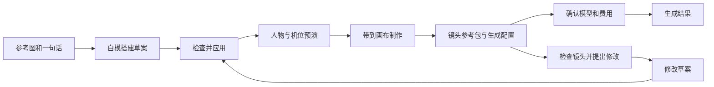

# XOi 导演台 × 画布：从白模预演到 AI 制作

日期：2026-10-18　｜　状态：P0-A 与 P0-B 本地预演视频交接已交付；逐模型验收及后续阶段待实施　｜　依据：用户上传的 91 秒演示视频及当前仓库代码

## 1. 结论与产品目标

**可以基于现有导演台和画布实现类似工作流，主体是整合和补齐，而不是重做一套编辑器。**

最值得做的是：参考图辅助搭白模 → 调人物与机位 → 本地预演 → 把对应镜头的预演、角色、场景参考交给画布 → AI 制作 → 返回导演台修改。

难度主要分三层：

- **已有基础上可较快补齐**：镜头截图带入画布、编辑入口互通、场景版本卡片、套用运镜、整理参考素材。
- **可实现但需要专项开发和验证**：图片理解后搭白模、预演视频可靠导出和交接、AI 看预演提出修改、角色图像造型编辑。
- **不能作为首期简单承诺**：单图精确还原可编辑 3D 场景、人物图自动变成可换装且带骨骼的精细 3D 模型、AI 成片逐帧完全遵循相机和人物路线。

首期目标：让用户明确知道“我在搭什么、拍什么、哪些参考会用于生成、什么时候扣费”，完整完成一个 5–10 秒单镜头制作流程。

非首期目标：复制视频里的复杂打斗成片质量、完整物理破碎、布料毛发仿真、专业 DCC 建模、电影级精细角色系统。

## 2. 视频里的功能分别有什么用

分析方式：每秒检查嵌入字幕，按每三秒全帧及关键时间点复核。未另行转写原音轨。下列时间为约数，视频为剪辑演示，**不能据此认定结果是一次生成、没有后期，或存在特定内部算法**。

| 时间 | 视频展示 / 讲解 | 用户实际用途 | XOi 可实现性与难度 |
| --- | --- | --- | --- |
| 00:00–00:09 | 角色、城市、快速运镜等成片片段 | 展示最终视觉目标 | 最终质量取决于模型、参考和后期；不能算 3D 编辑器本身的能力 |
| 00:09–00:25 | 3D Box 白模摄影棚；参考图加一句话搭景 | 用简单几何说明空间、纵深、遮挡和人物位置 | 中高；已有文本搭景，需补图片理解和可控的重复结构模板；不等于真实场景重建 |
| 00:26–00:30 | “场景调度 / 成片预演”切换与播放 | 编辑视角摆东西，主摄影机视角看实际构图和运动 | 中低；现有编辑视角、主摄像机、人物和相机关键帧可以复用 |
| 00:30–00:35 | 导出面板包含视频、图片、3D 资产标签；进入画布 | 将预演结果用于后续制作 | 中；视频只实际演示了部分导出操作，3D 资产导出可用性未验证 |
| 00:35–00:45 | 画布里看白模，呼出“导演分身”分析 | 让 AI 理解镜头、动作和元素变化，给修改建议 | 中高；需传真实帧 / 预演和结构化场景，不是让 AI 只读提示词 |
| 00:45–01:09 | 回到 3D Box，把建议交给 Agent；改机位、布景、走位 | 以对话逐轮修正预演 | 中；现有调整场景、镜头设计可复用。XOi 应直接交接可审阅修改，省掉人工复制给另一个助手 |
| 01:10–01:20 | 导入人物图，调整五官、身体、服装等参数并生成 | 做角色设定、外观变体和一致性参考 | 图像版中等；精细可编辑 3D 角色版高难。视频不能证明后者，应分开立项 |
| 01:22–01:27 | 角色图、场景图、白模预演组合到画布生成 | 分别约束角色外观、场景风格和运动 / 构图 | 中；已有多参考生成链路，但要按所选模型能力验证组合是否支持 |
| 01:27–01:31 | 成片展示 | 验证制作方向 | 工作流能做；“严格复刻预演”需独立测试，不能以剪辑演示保证成功率 |

参考关键帧：[白模摄影棚](./参考/2026-10-18视频功能拆解/12秒-白模摄影棚.jpg)、[预演与导出](./参考/2026-10-18视频功能拆解/30秒-预演与导出.jpg)、[画布对话](./参考/2026-10-18视频功能拆解/38秒-画布与导演对话.jpg)、[修改白模](./参考/2026-10-18视频功能拆解/48秒-对话调整白模.jpg)、[角色造型](./参考/2026-10-18视频功能拆解/76秒-角色造型.jpg)、[多参考生成](./参考/2026-10-18视频功能拆解/84秒-多参考生成工作流.jpg)。

实施进度见 [P0-A 交付与验收](./导演台与画布P0-A交付-2026-10-19.md)。本次只完成下述分期中的 P0-A，不把视频交接、图片搭景或 AI 镜头审阅算作已完成。

## 3. 现有代码基础与真正缺口

本节是源码检查结论，不代表本次重新跑过上线验收。

| 当前基础 | 已具备什么 | 本次需求还缺什么 |
| --- | --- | --- |
| `shared/directorMotion.ts`、`directorScenePresets.ts` | 基础白模物体、人物走位、六类运镜、时长适配、方案校验 | 复杂重复建筑模板、更多环境组件；图像到空间草图的转换 |
| `backend/src/utils/director/composer.ts` | 文本需求 → 有限操作 JSON；人工应用；禁止任意代码执行 | 当前请求主要传文字与场景 JSON，没有把参考图作为视觉输入；修改场景和机位的组合方案尚需统一组织 |
| `frontend/src/components/director/DirectorSkillsPanel.vue` | 生成、应用、撤销，搭景与设计镜头，费用状态 | 上下文共享、视觉检查、从画布回到相同镜头的结构化修改入口 |
| `shared/directorCanvas.ts`、`frontend/src/utils/directorScene.ts` | 方案提示词、当前主机位截图和视频配置带入画布 | 当前一张参考会供多个方案使用，且不等于各方案实际预演。应改成**每个已确认镜头独立导出自己的参考包** |
| 画布 `CanvasNodeType.Director`、`canvas-director.tsx` | 已有 3D 节点、原生编辑器、图片 / 视频导出事件接收；不必新增同义节点类型 | 当前 `project` 被当作旧格式提示，`onProjectChange` 等回调未形成完整的新工程同步；需统一主站和节点的场景身份与版本 |
| 画布 `canvas-client-page.tsx` 的 Director handlers | 已有图片 / 视频入画布、上传和连线逻辑 | 原生视频桥接中 `durationSeconds` 当前填写 0；需校验真实时长、帧率、shotId、导出版本和实际编码格式 |
| 画布 `canvas-agent-tools.ts` | 读取节点、整理连线、文字 / 图像 / 视频生成 | 还没有“读取 3D 场景状态 / 提交导演修改草案”等受控领域工具 |
| 视频适配 `video.ts`、`src/xoi/video-input.ts` | 已有图片、视频、音频参考及部分模型运动控制分支 | 代码存在分支不等于当前账号模型可用；需逐模型验证数量、时长、分辨率和输入语义，尤其不能混淆人物动作控制与相机轨迹控制 |
| 画布素材库、账号素材同步、工作区文档存储 | 账号隔离和素材持久化有基础 | 素材类型主要为文图音视频；工作区文档校验目前限制 `viral/timeline`，保存场景 / 运镜必须补类型、服务端校验和兼容迁移 |

**工程风险：仓内 MONOFORM 主要以构建产物及宿主辅助脚本存在。** 若要稳定增加逐帧采样、场景变更事件和导出协议，先确认可维护的原生引擎源码与构建方式。不能把长期修改压缩 JS 或依赖内部 React 对象作为正式方案。

## 4. 面向用户的整体流程



### 信息架构

- **导演台**：负责空间、人物调度、机位与本地预演。
- **画布**：负责参考素材组合、AI 视觉制作、版本比较和结果整理。
- **同一个镜头身份**贯穿两个入口。两边引用同一可恢复工程，不各建一个同名空场景。
- 主界面只突出“编辑场景 / 镜头预演”和“带到画布制作”。导出工程、详细参数、分析选项收进次级入口。
- 导演助理保留一个对话入口，内部区分场景、人物和机位修改；不要求用户理解两个 Agent 并反复复制文字。

示例：“人物太小，镜头靠近一点” → 生成“主角占画面比例提高，机位推进；人物位置不变”的草案。若“靠近”指向不清，先用“移动人物 / 推近相机”两个选项确认，不先收费调用后再猜测。

## 5. P0：先完成可靠的单镜头闭环

### F1. 参考图辅助搭景

输入：一句话、可选参考图、镜头时长、指定主体。输出为可编辑白模草案，不直接覆盖场景。

- 先支持空场、对话空间、桌边、走廊 / 平台四类模板。参考图解释大体层次、位置、纵深，不承诺恢复隐藏结构或精确尺寸。
- 图片有视觉模型才分析；仅文本模型时明确切换为文字搭景，不假装已识别图片。
- 走廊、立柱、台阶等重复结构优先用有边界的模板参数展开，避免让模型输出成百上千个坐标。
- 草案显示物体数量、主要位置和将改变的内容；先本地预览，再应用 / 撤销。
- 现有场景最多 120 个物体、一次动作数量受限，应沿用保护；新增批量模板也要计入同一上限。

### F2. 清楚区分编辑与预演

编辑视角用于摆放，镜头预演用于看拍摄结果。进入预演保留“暂停 / 从头重播 / 返回编辑”，Esc 可退出；关闭助理停止预演。

- 镜头运动有轨迹才标“相机移动”，人物有位移才标“人物走位”。
- 前后跟随没有人物路线时说明前提，提供补起终点或示例走位；不显示假播放。
- 默认一次只显示一个高质量 3D 视窗。画布上用封面和普通视频预览，不给每个节点常驻 WebGL 引擎。

### F3. 一键带到画布：传“镜头参考包”

按钮名：**带到画布制作**。导出所选镜头，不自动启动 AI。

参考包包含：

1. 可重新打开的导演节点，保存工程 / 镜头身份及导出时版本。
2. 当前镜头封面、起点与终点；运动镜头附本地预演视频。
3. 角色外观参考、场景风格参考，按主体关联；用户可以补充或更换。
4. 精简镜头说明和一个生成配置，继承画幅及本镜时长。

默认布局：

```text
[3D 镜头卡片] ── [预演视频] ──────────┐
[角色 A / B 参考] ───────────────────┤
[场景风格参考] ──────────────────────┼─ [视频生成配置] → [结果]
[镜头说明] ──────────────────────────┘
```

- 复用现有 Director、Image、Video、Text、Config 节点；暂不增加一套“新 3D Box”编辑器。
- 角色图控制外观，场景图控制风格，白模控制构图 / 运动参考，三者在 UI 上标明用途，不能只显示没有语义的“参考图 4 张”。
- AI 镜头方案尚未应用时，提示先预演 / 应用，再导出；不能把旧机位截图标成新方案结果。
- 每个镜头独立导出、独立 shotId 和 sceneRevision。不能让多个镜头共用一张“当前机位”图冒充各自构图。
- 同一导出 requestId 重复点击只聚焦原节点组；用户修改后可显式“新建参考版本”，不覆写已生成内容。
- 仍使用现有画布运行时，不为这一功能新增本地常驻端口。

### F4. 预演视频导出与失败恢复

已有 MP4 导出和视频回传基础，应先复用并实测，而不是重写录屏器。

- 校验真实 MIME、编码、宽高、帧率、时长、镜头版本；不能只把文件后缀改为 mp4。
- 只导出摄影机画面，不含网格、控件、选中框和品牌悬浮 UI；导出时保持导出前编辑状态，结束 / 取消后恢复。
- 优先按时间线采样导出；若现有方案是实时录制，需要验证慢设备、丢帧、后台标签和暂停，不承诺绝对帧准确。
- 支持单图导出先完成；视频失败保留工程和已有截图，提供重试导出，不能顺带调用 AI“补救”。
- 视频先上传为账号可恢复资产，成功后再提交画布引用；不用临时 blob URL 或大段 base64 作为跨设备唯一存储。
- 建议默认 720p、5–10 秒、每次 1 个镜头，其他参数受模型和设备能力约束。

### F5. 模型适配与生成

- 生成前检验本模型是否支持“多角色图 + 场景图 + 预演视频”，展示所用参考及其用途。
- 不支持视频参考时阻止原组合，并提供明确选择：换支持模型，或使用关键帧图片和文字作较弱参考。不能静默丢掉视频。
- 不支持当前时长或画幅时显示修改方案及更新报价，不能后台偷偷截短、改比例、自动拆成多次付费任务。
- 普通参考视频输入，不等于模型能读取我们的相机曲线。成片默认标为“参考预演生成”，需要实际样例证明后才能声称更精确的运动控制。
- 画布无需把内部物体 ID、时间线 JSON 原样当作视频提示词；转换为镜头说明，真实几何信息用于本地校验和预演。

## 6. P1：让对话形成可编辑的往返

### F6. AI 检查预演并提出修改

在导演节点或预演视频上点“检查镜头”，携带当前场景摘要、指定主体、选定帧及用户目标。支持视频理解才直接发送视频，否则使用明确标注的抽帧检查，不能称其完整理解连续运动。

输出应分两部分：

- 人能懂的观察：“主角在后半段离开画面”“前景挡住入口”。指出对应时间；不能确认时标不确定。
- 可应用的修改草案：人物、布景、灯光、相机分别列出。AI 返回受限 JSON，服务端校验，不能执行任意脚本。

只涉及人物大小、画外、相机速度等几何问题，优先本地规则检查，减少不必要模型调用。复杂审美和叙事分析才调用 AI。

用户点“应用并预演”后，在同一镜头建立可撤销修订；涉及场景和机位的混合需求一次审阅、一次事务提交，内部仍严格区分字段。若基础版本已被修改，先显示冲突，不套用过期方案。

视频里“导演建议复制给另一个 Agent”的做法不必照搬。我们用同一份修改草案交接，避免再次解释需求、重复收费和上下文丢失。

### F7. 我的运镜 / 我的场景

有必要，但先作为导演台素材栏内的分类，不另建庞大资产中心。

- 场景模板保存布局及资源引用；运镜模板保存归一化时间、焦距和相对主体的机位 / 朝向关系。
- 复用时选新主体，按新位置、朝向和合理尺度适配，先看草稿再加入镜头。
- 依赖人物走位的运镜，要提示补路线；不自动替换用户未指定人物。
- 提供命名、缩略图、复制和删除。删除收藏不删除已经应用的镜头。
- 账号云端同步，版本可升级；现有素材 / 文档存储要正式增加类型和校验，不能仅往现有 text 字段塞任意 JSON。
- 收藏、应用、预演、撤销不调用模型。要求 AI 重新设计才确认新的调用费用。

## 7. P2：角色造型工作台，先做图像版

入口复用现有角色资产：上传 / 选择人物图 → 保留身份特征 → 输入外观修改 → 生成候选 → 对比 → 保存角色版本 → 加入画布参考。

首版只做三组易懂控制：脸与发型、体型描述、服装与配色。可提供文字和有限枚举，不堆“皮肤纹理 63”之类无法验证效果的精密滑杆。

- 调参数只更新意图和预览说明，点“生成候选”才调用图像模型。
- 标明哪些内容尽量保留、哪些需要改变；保持同一身份是模型能力和样例验证目标，不承诺绝不变脸。
- 选定图保存为新的角色参考版本；不覆盖已有成片所用版本。
- 多视图应有一致性检查；不能把多张独立生成的图片自动当作真实 3D 几何。
- 真正 3D 捏脸、服装网格、重绑定骨骼、动作迁移另行立项，首期不与图像生成混为一谈。

## 8. 状态与费用规则

| 操作 | 模型调用 / 积分 | 产品反馈 |
| --- | --- | --- |
| 手动摆放、内置模板、轨迹、预演、截图 / 视频本地导出 | 不调用模型，不扣 AI 积分 | 展示本地任务进度；上传 / 存储限制另明确说明 |
| 带入画布、返回编辑、同步参考、收藏、撤销 | 不调用模型，不扣 AI 积分 | 交接成功再切换，失败保留原工程与草稿 |
| AI 图片搭景 / 修改 / 检查镜头 | 文本或视觉模型，按所选模型和实际用量 | 确认模型、输入种类和预算后调用；本地应用不再收费 |
| 生成角色图 | 图像模型调用 | 每次明确候选数量和价格，不因滑动参数自动生成 |
| 生成成片 | 视频模型调用 | 单独确认时长、清晰度、参考、次数和费用 |
| 超时 / 断网 / 返回无效方案 | 已提交请求可能计费，不能直接标 0 | 查原请求状态；不自动二次提交，也不永久卡住场景编辑 |

预演交接：`保存版本 → 导出 → 上传 → 写入画布 → 就绪`，每步可失败恢复。编辑与预演不依赖账单回传。

模型任务：`待确认 → 已提交 → 运行 → 成功 / 失败 / 状态待核实`。提交后取消只表示停止后续动作，不能伪称上游已取消或已退款。实际账单以原请求回执为准。

沿用现有费用门禁和后端校验。一次改镜头不自动触发“分析 → 改场景 → 生图 → 生视频”四次调用。若未来提供组合任务，必须先展示步骤、次数与总预算上限。

## 9. 数据与桥接原则

建议建立统一 DirectorSceneDocument 与 ShotReferencePackage，以下是新增契约草案，尚非现有 API：

```text
DirectorSceneDocument
  schemaVersion, sceneId, revision, shots[], activeShotId, assets[]
  owner 由登录身份确定；不信任前端传入的所有者

ShotReferencePackage
  id, sceneId, sceneRevision, shotId, exportRequestId
  durationSeconds, fps, aspectRatio
  coverAssetId, keyframeAssetIds[], previzAssetId?
  references[{assetId, role: character|environment|motion, subjectId?}]
  prompt, createdAt

DirectorChangeSet
  id, sceneId, shotId, baseRevision
  objectChanges[], cameraChanges[], lightingChanges[]
  warnings[], sourceRequestId
```

- 场景 JSON 与媒体分离；媒体通过资产 ID 关联，不嵌入登录凭据和临时下载授权。
- 同源消息要检验 origin、source、requestId、场景归属与消息大小；跨账号、过期请求、已关闭编辑器的延迟响应不能修改当前工程。
- 画布保存某个导出版本；返回编辑改动后提示“参考来自旧版本”，用户主动更新。已生成结果的来源保持可追溯。
- 旧 `directorProject` 先保留为 legacy，读取失败可下载原工程；不能自动当空场景覆盖保存。
- 图片理解和预演分析中的文字均为内容数据，不作为执行权限。工具只能改用户选定场景，禁止任意文件 / 网络 / 代码工具。

## 10. 分期与工作量判断

以下是基于源码检查的工程估算，假设 1 名熟悉项目的全栈开发、可维护的原生 3D 源码、复用现有模型网关；是人日估算，不是上线日期。模型接入、样例验证、设计与测试需安排资源，不能把几个按钮的开发时间当全部交付成本。

| 阶段 | 交付 | 估算 / 难点 |
| --- | --- | --- |
| 技术验证 | 同一镜头开回不丢数据；一段真实 5 秒视频导出 / 回传；一个已配置模型接受所需参考组合 | 2–4 人日；先核实原生源码与模型能力，不通过则先做静态参考版 |
| P0-A | 统一场景身份、保存修订、导演节点互通、镜头截图参考包、布局与失败恢复 | 5–8 人日；现有能力复用最多，建议先交付 |
| P0-B | 预演视频可靠交接、多参考语义与能力检验、费用门禁回归 | 5–9 人日；设备与模型差异是主要风险 |
| P0-C | 图片辅助搭景、重复结构模板、有限操作草案 | 5–9 人日；视觉输出质量与复杂场景控制 |
| P1 | 检查预演 → 修改草案 → 应用预演；我的运镜 | 7–12 人日；版本冲突、视觉分析和跨主体适配 |
| P2 | 角色图像造型、版本及参考复用 | 5–10 人日；参考一致性与图像编辑模型实测 |
| 专项研究 | 精细 3D 角色、真实服装与物理、严格相机轨迹控制 | 不在上述估算，需单独验证技术路线 |

**推荐先批准技术验证和 P0-A，再接视频参考，最后扩图片搭景与角色造型。** 不建议先做复杂角色滑杆或复制整套竞品 UI。若无法取得可维护引擎源码，先完成静态截图闭环；视频导出和深度编辑协议的排期必须重新评估。

## 11. 验收标准

1. 从主站导演台带到画布，再从导演节点返回，打开同一个场景、同一个镜头和明确的版本；刷新及换设备可恢复已保存内容。
2. 一次导出中的截图、视频和参数属于同一 shotId / revision；多镜头不混用当前截图；尚未应用的 AI 方案不冒充预演。
3. 5 秒测试镜头的导出时长与起终点正确；暂停 / 取消 / 导出失败后仍可编辑。对支持逐帧采样的编码路径，帧数按约定帧率核对；其他路径先制定实测容差。
4. 正常设备 / 慢设备、隐藏标签、WebGL 上下文丢失、存储空间不足各有明确恢复路径；参考包失败不调用模型。
5. 普通打开画布只展示节点封面，多个导演节点不常驻多个 3D 渲染器。
6. 选择不支持视频参考的模型时拦截，不静默丢参考；更换模型不会自动开始新任务。
7. 带入、预演、收藏、撤销的网络审计中没有模型请求或收费授权；生成取消未提交请求，重试不重复提交同一任务。
8. AI 修改必须可审阅、可撤销；过期版本、锁定物体、越权工程和未确认的删除操作被拦截。
9. 角色生成候选与原图并排，候选不覆盖原资产，已制作镜头保留原参考版本。
10. 对“图像 + 白模运动视频 → 成片”采用至少 10 个固定测试镜头覆盖对话、跟随、环绕、遮挡和双人物；记录身份、构图、运动方向、时长和真实费用，得到样例结果前不宣传精确复刻。

建议观察：从确认预演到画布就绪的成功率、参考误用次数、同请求重复提交次数、一次生成后的有效采用率与用户返回修改次数。时延指标先量基线，再定 P95 目标，不直接承诺“秒开”。

## 12. 交付边界与待验证项

本节记录需求分析阶段的边界；实施进度与最新验收见 [预演视频交接交付](./导演台预演视频交接交付-2026-10-19.md)。

本次仅做本地视频分析、源码对照和 PRD 编写；没有接入 / 调用参考视频里的产品服务，没有测试第三方私有 API，没有调用付费模型，也没有修改运行中的产品功能。

立项前必须验证：原生引擎源码与许可证、导出编解码可维护性、当前账号可用模型的参考组合及真实费用、图片搭景可接受的复杂度。视频里的精细角色来源、真实控制算法、生成重试次数和后期处理仍未知。

附：来源指纹与分析方法见 [来源记录](./参考/2026-10-18视频功能拆解/来源.json)。前一份 [运镜复用与画布流畅性 PRD](./3D导演台运镜复用与画布流畅性PRD-2026-10-17.md) 可作为“我的运镜”详细设计基础。
