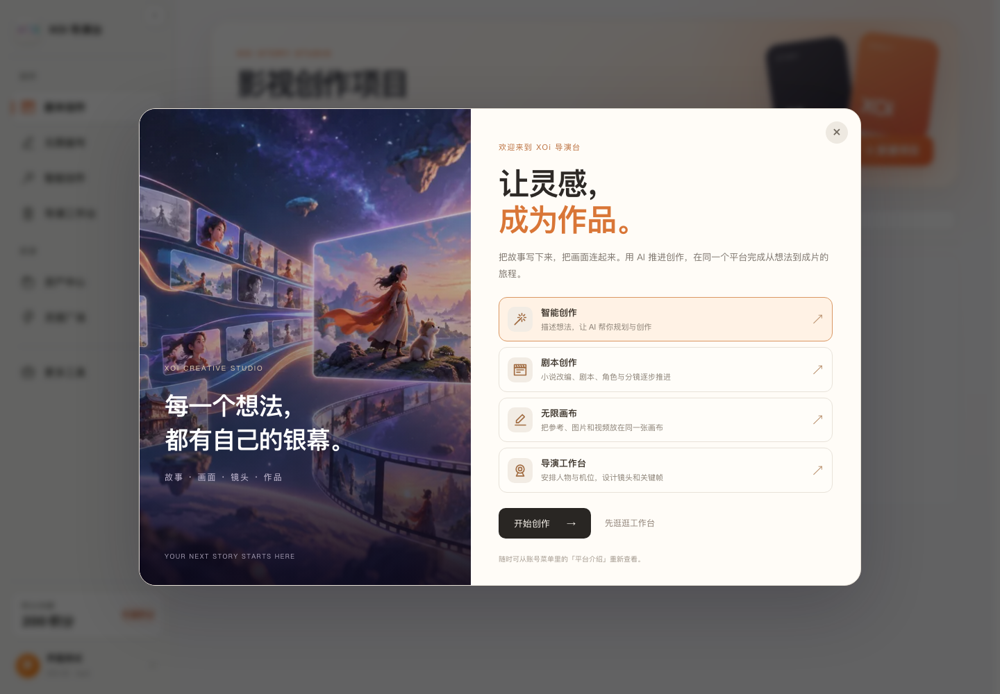
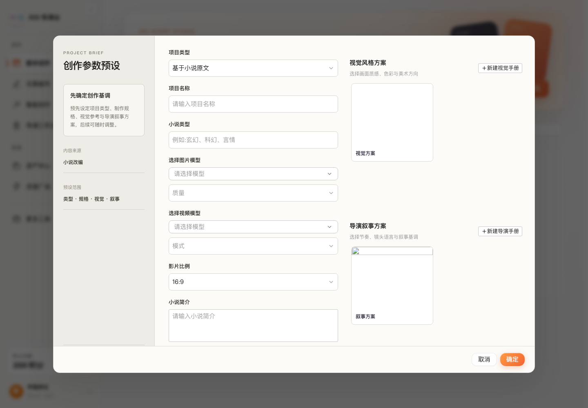
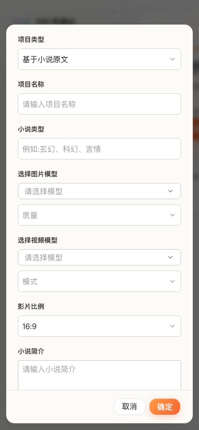

# 平台优化验证（2026-10-11）

本次范围：保留现有创作、账号和管理功能，替换旧首次引导，优化加载和请求、修正新建项目排版，完成服务器部署评估。没有部署生产服务器或执行 2000 并发压测。

## 功能保留

- 登录页继续保留三维模型地球、作品展映与切换按钮；三维模块延后加载，登录弹窗打开时暂停背景帧循环。
- 密码登录、团队登录、注册与邀请归因继续保留。
- 智能创作、剧本创作、无限画布、导演工作台、资产、剪辑、Skill 和管理页面继续使用原有路由。
- 项目打开前继续验证图片与视频模型，两项检查并行执行；模型停用时仍提示并打开项目设置。
- 新建项目保留全部参数、模型选择、质量、模式、比例、视觉手册、导演手册和编辑器。只调整布局，并按打开时加载编辑器。
- 旧版本的首次引导替换为平台介绍；介绍可关闭、按账号记忆，并从账号菜单再次打开。

## 验证结果

| 检查 | 结果 | 范围 |
| --- | --- | --- |
| Vue 类型检查、生产构建 | 通过 | 当前前端源码与产物 |
| React 控制台类型检查、生产构建 | 通过 | 登录和管理路由拆分 |
| 后端 TypeScript 检查 | 通过 | 数据库池与余额读取等现有源码 |
| 后端测试 | 59 通过，0 失败 | 现有自动化测试，不代表所有产品流程均实测 |
| 桌面与手机新建项目 | 通过 | 1440×1000、390×844，7 个字段标签均无重叠，手机无横向溢出 |
| 新平台介绍 | 通过 | 首次显示，关闭后刷新不重复 |
| 手册与模型校验 | 通过 | 两种手册编辑器可打开，模型停用仍进入设置 |
| 控制台交互 | 通过 | 登录、团队登录、注册、作品展映切换；登录未提前下载管理页面 |

浏览器检查使用隔离的模拟账号和 API 数据，没有创建真实项目、登录真实账号或调用收费模型。控制台 DOM 检查替换了 WebGL 渲染模块，以避免无头浏览器软件渲染影响操作；真实三维画面与媒体播放仍应在有 GPU 的用户设备上验收。截图中的项目方案是测试数据，不能作为真实账号资源内容的证明。

主站入口 JS 文件实际字节数：3,681,103 → 969,770，减少 **73.7%**；gzip 678,531 → 278,837 字节，减少约 **58.9%**。这只比较主入口文件，并非所有页面依赖总量，也不是端到端登录延迟实测。大编辑器、视频和创作模块仍保留，按页面加载。

已同步最新主站与控制台产物到 `backend/data/web`，本地 10588 的前端刷新即可读取。数据库连接池与余额读取的后端源码优化在下一次正常发布/安全重启后启用；本次没有重启现有后端进程，以免打断进程内生成任务。

## 页面预览

服务器建议、扩容阻塞点、采购规格、上线流程和压测脚本见 [服务器部署与2000并发评估](服务器部署与2000并发评估-2026-10-11.md)。2000 人在线与 2000 个 AI 生成任务需分别验证，上游模型配额需要单独确认。
