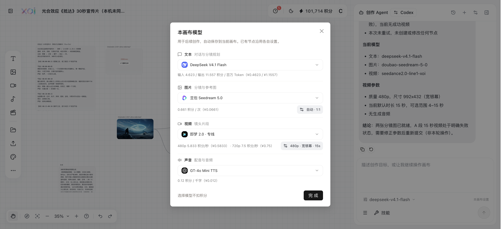
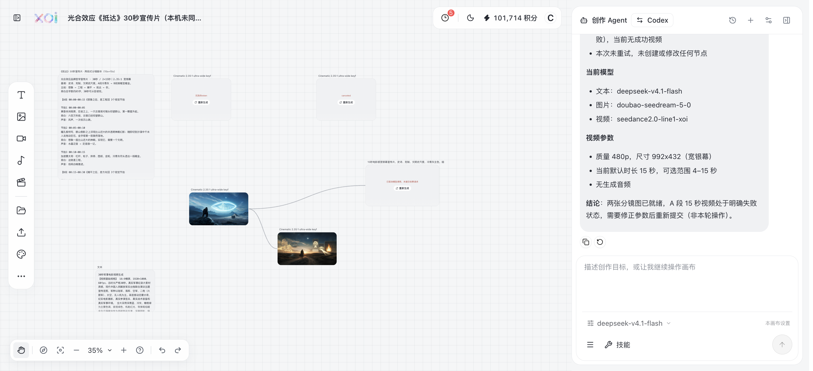

# 画布造物接入诊断与修复

日期：2026-10-25（Asia/Shanghai）。目标：排查 Agent 空回复、优化造物文本接入并尽量复用已有成果。

## 当前结论

- 真实账号下，DeepSeek 普通中文对话成功。
- 在保留 7 个节点的《抵达》画布上，真实完成：用户需求 → DeepSeek 返回两个 JSON 工具动作 → 读取画布摘要和模型配置 → 再次调用 DeepSeek → 页面显示中文回复。
- 两张已有豆包分镜图均正常显示；本轮没有重新生成图片。
- Seedance 生成与视频播放尚未完成验收。本轮没有提交视频或音频生成，不能宣称全部渠道稳定可用。
- 最新宿主及画布构建通过，已同步至 backend/data/web，发布保留旧哈希资源。

正确成果画布：<http://localhost:12121/#/canvas?id=JkqcrNhamAvqcejN67_cb>。

## 查到的问题

1. 历史账单存在 DeepSeek HTTP 成功、completion_tokens=0 的记录（如日志 421、422、428）；输入已计费。历史原始响应未完整保存，无法证明每次空回复都只有一个原因。
2. 造物当前 deepseek-v4.1-flash 的模型目录提供 reasoning_effort=none，默认 high。旧代码仅发送 thinking.disabled，未按该线路明确关闭默认思考。造物源码 src/lib/thinking-effort.ts 也使用目录声明的 none。
3. 旧画布请求使用 stream:false；造物 src/data/api-docs.ts 建议推理线路使用 SSE。原超时只覆盖响应头，正文等待可能不受 150 秒限制。
4. 长会话会先购买摘要，随后仍因手册、工具定义、快照及固定保留的 3K 历史合计超限而停止。本轮在真实成果画布上复现此问题，并追加对应回归验证。
5. 预算估算与实际请求没有统一使用文本模型；全局默认图片模型可能影响提示词压缩判断。
6. 当地址栏从一个画布 id 切到另一个 id，宿主原来没有把切换传入常驻编辑器。实际观察到外层 id 与内层画布不一致。
7. 起初打开的 ilm8fc5V8ZZDCQUX3kDcs 是空副本，包含聊天记录但没有节点。已有成果仍保存在 JkqcrNhamAvqcejN67_cb，未丢失。
8. 已有视频节点 video-1792829093202-g0pby 的 errorDetails 为“已取消模型调用，未提交收费请求”，任务编号仅为本地 client_video_task 占位。它不是一次已确认提交上游的 Seedance 生成结果。

## 修复内容

- DeepSeek V4.1 显式发送 reasoning_effort:none；DeepSeek 接收 SSE，保留输出上限和 usage。
- 超时覆盖读取完整响应；支持 event/id/retry 前缀、BOM、usage 尾包；断流未结束不执行工具。
- 成功但空输出不再伪装成上下文超限，避免 runtime 自动购买摘要并重新收费；空消息、仅思考内容和流内错误明确停止。
- 输入预算与实际文本请求使用同一模型和渠道；先免费压缩手册，必要时才摘要，DeepSeek 缩减历史及快照预算。
- 明确“只读”请求只加载读取工具；执行前再次校验本轮工具范围，防止旧历史中的写入或媒体动作越过本轮约束。
- 视频时长兼容 videoSeconds、duration、duration_seconds；冲突时停止，不擅自选择不同秒数。已有 videoSize、videoGenerateAudio 兼容保留。
- 宿主 id 切换传入现有编辑器，切换前保存当前画布；不会为切换重新加载一份编辑器。
- 只读画布摘要带短错误原因；交接状态提示不再遮挡返回按钮。

## 真实验收与费用

本轮新增 6 笔 DeepSeek 文本调用，含一次长会话摘要；无图片、视频、声音调用。
费用按 NewAPI logs 实际 quota 汇总，1 元=500000 quota=10 积分。

|日志 ID|用途|输入 / 输出 Token|quota|
|---|---|---:|---:|
|444|修复前普通中文对话|2741 / 3|635|
|445|修复前读取摘要工具|2793 / 25|660|
|446|修复前工具后中文回复|2950 / 215|806|
|447|长会话摘要，随后复现输入预算阻塞|1173 / 561|595|
|448|修复后真实成果画布：返回 get_canvas_summary、get_generation_config|1920 / 47|471|
|449|修复后读取结果并在页面中文回复|2570 / 273|752|

合计 3919 quota = **0.07838 积分 = ¥0.007838**。

最新两笔 SSE 均正常结束，reasoning_tokens=0；正文及 JSON 工具指令均识别成功。
请求输出上限 2048；请求体约 11067 / 13093 字符。浏览器捕获到媒体提交次数 0。

## 模型设置验收

通过真实页面选择并保存，刷新后重开弹窗、从账户菜单“画布模型”再次打开，显示一致：

- 文本：deepseek-v4.1-flash。
- 图片：doubao-seedream-5-0。
- 视频：seedance2.0-line1-xoi；480p，992x432，15 秒，无生成音频。
- 声音：保留 gpt-4o-mini-tts，本轮未调用。

未修改已有节点的独立模型设置；原始画布节点及失败记录保留。

## 自动检查

- test-canvas-agent-output.mjs：通过。覆盖空成功响应不重试、V4.1 参数、完整/断流 SSE、正文超时、视频参数别名与时长冲突。
- test-canvas-runtime-budget.mjs：通过。覆盖空画布、非空画布、长会话、不同全局图片模型、只读工具执行约束；另外使用真实项目快照在本地无网络重放通过。
- test-canvas-memory-window.mjs：通过，保留最新用户要求、限制摘要输入。
- verify-canvas-flow.mjs：最新构建浏览器回归通过，包括常驻编辑器 id 切换、需求交接、输入保留、配置卡片、取消费用确认不提交。
- test-canvas-text-budget.mjs：校正旧断言以匹配已有 automatic:false 字段和免费账单静默行为，通过 Agent 停止信号验证同一文字工作流授权及停止行为。
- 画布与宿主 Vite 构建通过。全量 Atelier typecheck 仍有已有跨上游路径及 LocalUser.role 等错误；本轮没有将它描述为通过。

## 待验收

Seedance 的真实提交、完成结果与页面播放仍需一次受控媒体调用；已有 A 段取消节点不能代替成功验收。其他未调用的造物型号也不在本次成功范围内。当前修复降低已发现的接入故障，无法承诺外部上游永不空回、超时或失败。

